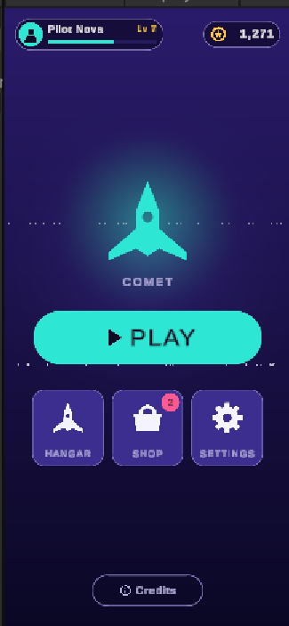
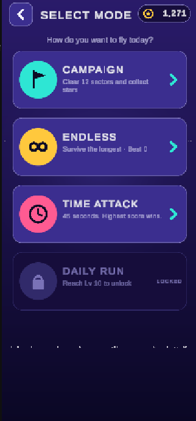
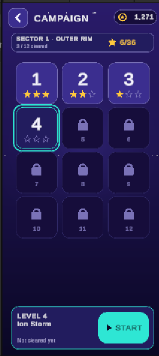
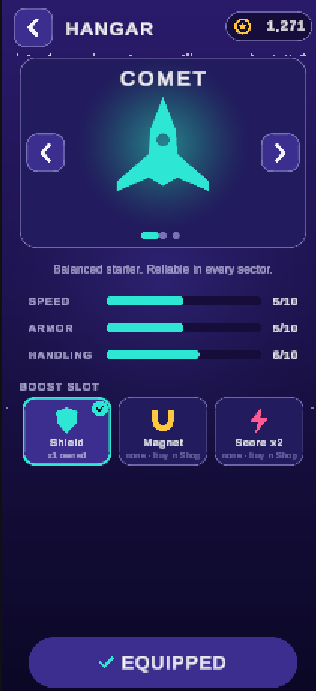
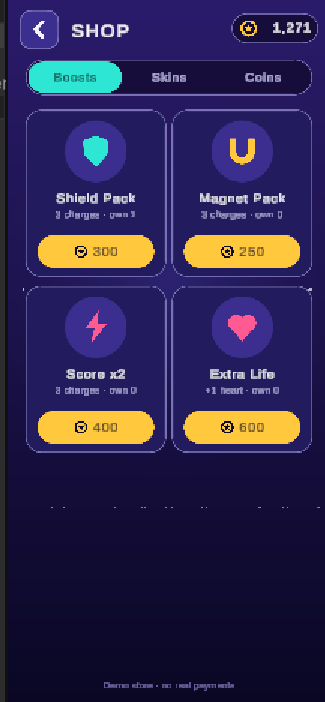
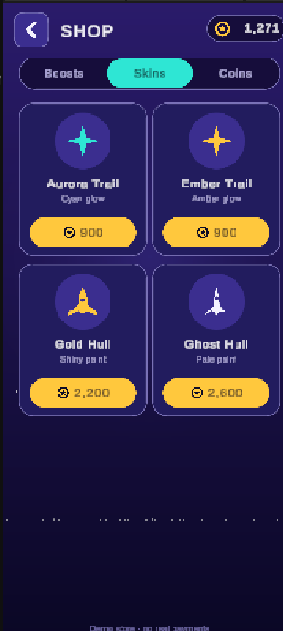
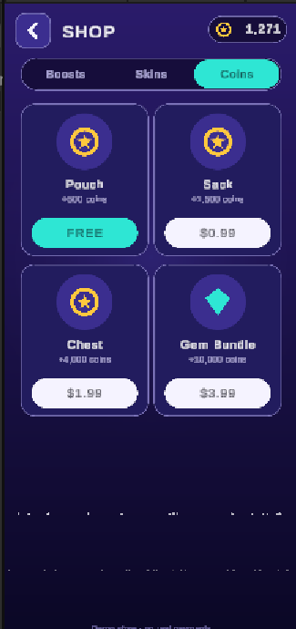
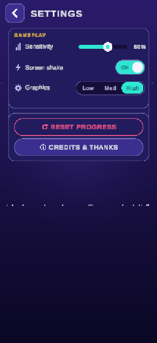
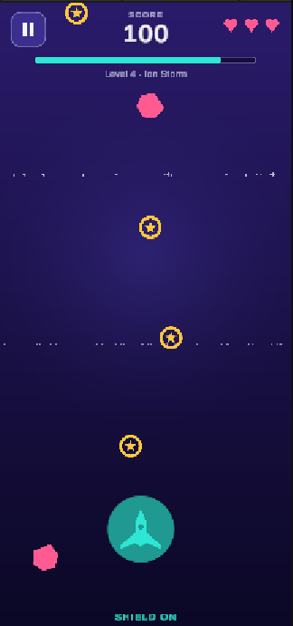

# Tayyab RUSH - Lab 07 Mobile Menu System (ITU CS-464)

Unity **6000.3.24f1**, uGUI + TextMeshPro. Portrait 1080x1920 canvas, anchored layout, safe-area aware.
Run: open the project, open `Assets/Lab07/Scenes/Menu.unity`, press Play (Game view: portrait / 1080x1920).
## Demo Video
- [Watch / Download Demo Video (lab7_recording.mp4)](lab7_recording.mp4)

<video src="lab7_recording.mp4" width="360" controls></video>

## Screens and flow
Title -> Main Menu -> Mode Select -> Level Select -> (short play) -> Pause / Results.
Main Menu also opens Hangar (loadout), Shop, Settings, Credits. Every screen has a Back button (top-left) or a Home/Resume button.

| # | Screen | Purpose | Tweens / ease |
|---|--------|---------|---------------|
| 1 | Title | Logo, loading bar, tap to start | Logo OutBack; loading bar InOutQuad; start-button halo OutQuad loop |
| 2 | Main Menu | Hub: Play, Hangar, Shop, Settings | Staggered rise OutCubic; PLAY halo loop; press scale OutQuad/OutBack |
| 3 | Mode Select | Campaign / Endless / Time Attack / locked | Cards slide in OutCubic; locked card shake |
| 4 | Level Select | 12 levels, stars, locks | Nodes pop OutBack; selection ring OutBack |
| 5 | Hangar | Ship carousel, stats, boost slot | Ship swap InQuad out / OutCubic in; stat bars OutCubic |
| 6 | Shop | Tabs, buy items, coin counter | Tab slide InQuad/OutCubic; purchase OutElastic; coin count OutQuart |
| 7 | Settings | Sensitivity, shake, quality, reset | Toggle knob OutCubic; segment pill OutBack |
| 8 | Pause | Modal over gameplay | Dim fade OutQuad; card OutBack in / InBack out |
| 9 | Results | Stars, score, next / retry / home | Banner OutBounce; stars OutElastic; score OutQuart |
| 10 | Credits | Auto-scrolling credits | Linear scroll |

Design notes (applied on every screen): one primary button per screen (cyan, largest), secondary buttons smaller on a panel colour,
text >= 36 px, touch targets >= 120 px, 40 px side margins, same header (Back left, title, coins right), state shown by colour + icon/label
(lock icon, check mark, ON/OFF text, filled vs outline stars) so it still reads in greyscale.

## 📱 Mobile Build (Android APK)
- **Direct Download**: [Download TayyabRush.apk](Builds/TayyabRush.apk)
- **One-Click Unity Build**: In the Unity Editor, click **`Lab07 > Build Android APK`** from the top menu to generate `Builds/TayyabRush.apk`.

---

## Screenshots

### Main Menu

### Mode Select

### Level Select

### Hangar

### Shop - Boosts

### Shop - Skins

### Shop - Coins

### Settings

### Gameplay

